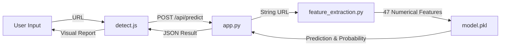

# PHISHIED System Architecture

This document explains how the PHISHIED phishing detection system works, from the user interface to the machine learning model.

## 1. High-Level Data Flow

1.  **User Input**: User enters a URL in the browser (`detect.html`).
2.  **Frontend Logic**: `detect.js` captures the URL and sends a generic `POST` request to the backend.
3.  **Backend API**: `app.py` (Flask) receives the request at `/api/predict`.
4.  **Feature Extraction**: `feature_extraction.py` analyzes the URL string and generates **47 numerical features**.
5.  **Inference**: The pre-trained **Gradient Boosting Model** (`model.pkl`) processes these features to predict probability.
6.  **Response**: The result (Phishing/Legitimate) and feature details are sent back to the frontend for display.

## 2. Component Details

### A. Frontend (`index.html`, `detect.html`, `js/detect.js`)
-   **Structure**: Static HTML pages using **Bootstrap 5** for styling.
-   **Logic (`detect.js`)**:
    -   Listens for the "Check Status" button click.
    -   Validates the URL input.
    -   Uses `fetch()` to send the URL to the Python backend.
    -   Parses the JSON response.
    -   Updates the UI with the result (Safe/Phishing) and renders the list of 47 extracted features using a dynamic loop.

### B. Backend (`app.py`)
-   **Framework**: **Flask** (lightweight Python web server).
-   **Initialization**: Loads the trained machine learning model (`model.pkl`) into memory when the server starts.
-   **Endpoints**:
    -   `/`: Serves the home page.
    -   `/api/predict`: The core logic. It accepts JSON `{'url': '...'}` and returns JSON with prediction, confidence score, and the raw feature vector.

### C. Feature Extraction (`feature_extraction.py`)
This is the "brain" of the preprocessing. It converts a text URL into 47 understandable numbers for the AI.
-   **Lexical Features**: Counts of characters (`.`, `-`, `@`, `//`), length of URL/hostname.
-   **Pattern Matching**: Checks for IP addresses, `https` token, or specific Phishing keywords (e.g., "secure", "login").
-   **Advanced Features**:
    -   `ratio_digits_url`: Density of numbers in the URL.
    -   `tld_in_path`: Detection of Top-Level Domains (like .com) hidden in the path (a common trick).
    -   `shannon_entropy` (represented via character repeats and unique stats).

### D. Machine Learning Model (`train_model.py`)
-   **Algorithm**: **Gradient Boosting Classifier** (via `scikit-learn`).
-   **Training Data**: `Training.parquet` containing ~7,600 labeled URLs (50% Phishing, 50% Legitimate).
-   **Performance**: Achieves **~90.1% accuracy** on unseen test data.
-   **Process**:
    1.  Loads the parquet dataset.
    2.  Maps columns to the expected 47 features.
    3.  Trains the ensemble model.
    4.  Saves the trained artifact to `model.pkl`.

## 3. Why it works
Phishing URLs often share structural traits distinct from legitimate ones:
-   They are longer and more complex.
-   They use more dots (`.`) and hyphens (`-`) to mimic subdomains.
-   They often contain IP addresses instead of domain names.
-   They try to hide the destination using redirection (`//` inside the path).

By analyzing these *lexical* traits (the text itself) rather than strictly relying on a blacklist, the system can detect **Zero-Day** (new, unknown) phishing sites.
